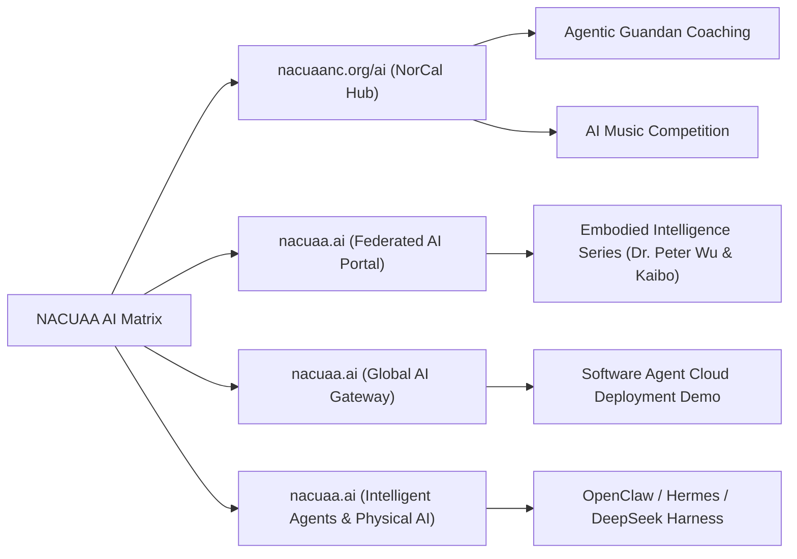

# 北美高校联盟北加州分会 (NACUAANC) 全景展示与俱乐部生态
# NACUAANC & Specialized Clubs Ecosystem: Comprehensive Presentation

> **Portal Websites**:
> - 🌐 **Main Hub**: [nacuaanc.org](https://nacuaanc.org)
> - 🤖 **AI Venture & Public Welfare Club**: [nacuaanc.org/ai](https://nacuaanc.org/ai) · [nacuaa.ai](https://nacuaa.ai) · [nacuaa.ai](https://nacuaa.ai) · [nacuaa.ai](https://nacuaa.ai)
> - 🎴 **Guandan Club**: [nacuaanc.org/guandan](https://nacuaanc.org/guandan)
> - 🥾 **Hiking & Trailblazers Club**: [nacuaanc.org/run](https://nacuaanc.org/run) · [nacuaanc.org/hike](https://nacuaanc.org/hike)
> - 🏓 **Pickleball Club**: [nacuaanc.org/pickleball](https://nacuaanc.org/pickleball)
> - 🎵 **Music & Entertainment Club**: [nacuaanc.org/music](https://nacuaanc.org/music)
> - 🏛️ **Alliance Headquarters**: [nacuaa.org](http://nacuaa.org)

---

## 📖 目录 / Table of Contents
1. [机构简介与宗旨 / About NACUAANC & Mission](#1-机构简介与宗旨--about-nacuaanc--mission)
2. [五大主题俱乐部全景 / The Five Specialized Clubs](#2-五大主题俱乐部全景--the-five-specialized-clubs)
   - [🎴 1. 北加硅谷掼蛋俱乐部 / Guandan Club](#-1-北加硅谷掼蛋俱乐部--guandan-club)
   - [🥾 2. 北加硅谷追风健行群 / Hiking & Trailblazers Club](#-2-北加硅谷追风健行群--hiking--trailblazers-club)
   - [🏓 3. 北加硅谷匹克球俱乐部 / Pickleball Club](#-3-北加硅谷匹克球俱乐部--pickleball-club)
   - [🎵 4. 北加硅谷音乐玩乐群 / Music & Entertainment Club](#-4-北加硅谷音乐玩乐群--music--entertainment-club)
   - [🤖 5. AI 创业公益俱乐部 / AI Entrepreneurship Club](#-5-ai-创业公益俱乐部--ai-entrepreneurship-club)
3. [AI 生态矩阵与前沿讲座 / AI Ecosystem & Lecture Series](#3-ai-生态矩阵与前沿讲座--ai-ecosystem--lecture-series)
4. [核心领导团队与联络人 / Leadership & Contacts](#4-核心领导团队与联络人--leadership--contacts)
5. [组织架构与协办支持 / Organizational Structure & Partners](#5-组织架构与协办支持--organizational-structure--partners)

---

## 1. 机构简介与宗旨 / About NACUAANC & Mission

### 🇨🇳 中文简介
**北美高校联盟北加州分会 (NACUAANC)** 是北美高校联合会（NACUAA）在北加州及旧金山湾区的重要分支机构。分会致力于联结在北加州与硅谷工作、生活、创业的各大高校校友，打造一个集**科技创业、文体健康、公益互助、文化传播**于一体的高质量校友生态网络。

- **宗旨**：凝聚校友情谊 · 促进科技创新 · 倡导健康生活 · 服务华人社区
- **服务区域**：旧金山、硅谷（San Jose, Santa Clara, Sunnyvale, Palo Alto 等）、东湾、半岛及广大北加州地区。
- **发展特色**：深度结合硅谷科技前沿（AI 智能体、具身智能）与丰富多元的社区生活俱乐部，实现“科技赋能人文，社区滋养创新”。

### 🇺🇸 English Introduction
**North American Chinese University Alumni Alliance Northern California Chapter (NACUAANC)** is the regional hub of NACUAA serving the Greater San Francisco Bay Area and Northern California. NACUAANC unites alumni across prestigious universities working, living, and building enterprises in Silicon Valley and Northern California.

- **Core Mission**: Uniting Alumni Fellowships · Catalyzing Tech Innovation · Promoting Healthy Lifestyle · Serving the Community.
- **Service Scope**: San Francisco, Silicon Valley (San Jose, Santa Clara, Sunnyvale, Palo Alto, Mountain View), East Bay, Peninsula, and Northern California.
- **Key Distinctions**: Bridging cutting-edge Silicon Valley tech breakthroughs (AI Agents, Embodied Intelligence) with rich community life, creating a vibrant network where technology empowers culture and community fuels innovation.

---

## 2. 五大主题俱乐部全景 / The Five Specialized Clubs

为全面满足校友及亲友在智力竞技、户外运动、潮流体育、艺术创作与技术前沿等全方位需求，北加州分会携手硅谷分会全面设立并上线了五大专业俱乐部：

| 俱乐部名称 / Club Name | 专属路径 / URI Path | 核心特色 / Core Highlights |
| :--- | :--- | :--- |
| 🎴 **北加硅谷掼蛋俱乐部** | [`/guandan`](https://nacuaanc.org/guandan) | 线上/线下友谊赛、复式掼蛋锦标赛集训、AI 智能体教练实战 |
| 🥾 **北加硅谷追风健行群** | [`/run`](https://nacuaanc.org/run) · [`/hike`](https://nacuaanc.org/hike) | 湾区各大自然公园周末徒步、健行步道打卡、跑步健身与户外联谊 |
| 🏓 **北加硅谷匹克球俱乐部** | [`/pickleball`](https://nacuaanc.org/pickleball) | 潮流匹克球零基础教学、双打畅打沙龙、校友趣味排位联赛 |
| 🎵 **北加硅谷音乐玩乐群** | [`/music`](https://nacuaanc.org/music) | AI 音乐创作沙龙、合唱声乐、器乐交流、联办北美华人 AI 音乐大赛 |
| 🤖 **AI 创业公益俱乐部** | [`/ai`](https://nacuaanc.org/ai) | 大模型智能体实操、具身智能讲座、创业项目孵化辅导与技术开源 |

---

### 🎴 1. 北加硅谷掼蛋俱乐部 / Guandan Club
- **URI**: [`nacuaanc.org/guandan`](https://nacuaanc.org/guandan)
- **定位**：智力运动 · 文化传承 · 科学竞技
- **核心活动**：
  1. **智能体掼蛋 · 开锋课 (Agentic Guandan Opening Class)**：
     - **霍明旭（Michael HUO）**：分享零基础新手如何借助 AI 智能体协助记牌、复盘并快速入门。
     - **李泉（Tracy LI）**：分享如何使用 AI 掼蛋教练快速提高实战水平，以牌会友。
     - **蒋建良（James JIANG）**：第四届北美高校联盟复式掼蛋团体赛冠军得主，传授大赛夺冠秘籍与心理控盘技巧。
  2. **备战华体会掼蛋大赛**：组建高校联盟精锐战队参加北加州华人文化体育协会（华体会）掼蛋团体赛。

---

### 🥾 2. 北加硅谷追风健行群 / Hiking & Trailblazers Club
- **URI**: [`nacuaanc.org/run`](https://nacuaanc.org/run) 或 [`nacuaanc.org/hike`](https://nacuaanc.org/hike)
- **定位**：探索自然 · 挥洒汗水 · 释放活力
- **核心活动**：
  1. **周末湾区名山步道徒步**：Mission Peak, Castle Rock, Rancho San Antonio, Purisima Creek Redwoods 等。
  2. **城市绿道晨跑与夜跑**：Stanford Campus, Shoreline Park, Lake Elizabeth 等。
  3. **户外野营与摄影采风**：优胜美地 (Yosemite)、太浩湖 (Lake Tahoe) 季节性校友家庭露营联谊。

---

### 🏓 3. 北加硅谷匹克球俱乐部 / Pickleball Club
- **URI**: [`nacuaanc.org/pickleball`](https://nacuaanc.org/pickleball)
- **定位**：全民热潮 · 敏捷社交 · 轻松上手
- **核心活动**：
  1. **新手启蒙营**：为零基础校友提供规则讲解、正反手发球与截击指导。
  2. **周末双打 Open Play**：固定场地定期约打，增进跨校友会交流。
  3. **校友联谊杯匹克球排位赛**：趣味竞技与团体对抗赛。

---

### 🎵 4. 北加硅谷音乐玩乐群 / Music & Entertainment Club
- **URI**: [`nacuaanc.org/music`](https://nacuaanc.org/music)
- **定位**：声乐艺术 · 灵感碰撞 · 科技赋能音乐
- **核心活动**：
  1. **首届北美华人 AI 音乐大赛**：携手天露音乐 (Tianlu Music) 举办，探索 Suno/Udio 等生成式 AI 赋能的原创音乐创作。
  2. **音乐沙龙与声乐交流**：古典/现代钢琴器乐演奏会、声乐发声训练、室内乐合奏。
  3. **校友卡拉OK歌友会**：线下欢聚与艺术交流。

---

### 🤖 5. AI 创业公益俱乐部 / AI Entrepreneurship Club
- **URI**: [`nacuaanc.org/ai`](https://nacuaanc.org/ai) · [`nacuaa.ai`](https://nacuaa.ai) · [`nacuaa.ai`](https://nacuaa.ai) · [`nacuaa.ai`](https://nacuaa.ai)
- **定位**：前沿科技 · 智能体革命 · 创业孵化 · 公益技术普及
- **使命**：帮助每一位华人工程师、创业者及非技术背景校友掌握最新 AI 智能体技术，从“概念理解”跨越到“生产力部署与创业落地”。

---

## 3. AI 生态矩阵与前沿讲座 / AI Ecosystem & Lecture Series

AI 俱乐部已成功举办多场高规格、深影响力的专业讲座与创业对话，全网开放录像与开源课件：

### 📚 经典重磅讲座回顾 (Key Lecture Archives):

1. **具身智能与物理 AI 系列讲座 (Physical AI & Embodied Intelligence Series)**
   * **主讲嘉宾**：Peter Wu 博士（UC Berkeley 具身智能研究专家）、Kaibo 等。
   * **主题**：从 VLA (Vision-Language-Action) 到 World Models 的范式演进与机器人实时操作架构。
   * **战略资源**：本站提供完整战略白皮书《The Physical AI Era》与技术课件下载。

2. **《我的 AI 与我》创业炉边对话系列 (My AI & Me Fireside Chats)**
   * **形式**：线上全球直播，聚焦硅谷顶尖创业者使用 AI Agent 重塑日常工作流与创业实战。

3. **软件智能体最新进展与云部署演示 (Software Agents Progress & Cloud Demo)**
   * **内容**：OpenClaw、Hermes、IronClaw 云原生部署，DeepSeek Harness 运行时及多模态 Agent 实际落地范式。

---

## 4. 核心领导团队与联络人 / Leadership & Contacts

| 姓名 / Name | 职务 / Title | 负责领域 / Focus Area | 联络方式 / Contact |
| :--- | :--- | :--- | :--- |
| **张锐 (Jerry Zhang)** | 北美高校联盟北加州分会会长 | 分会全面统筹、校友会联络、跨界合作 | `@张锐Jerry 北加分会会长` |
| **彭启蕾 (Qilei Peng)** | 北美高校联盟旧金山分会会长 | 硅谷校友联络、企业合作、联合活动策划 | `@彭启蕾-硅谷分会会长` |
| **Rose Li** | 北美高校联盟北卡分会会长 | 跨州联动、东部分会支持 | `@Rose Li 北卡分会会长` |
| **霍明旭 (Michael HUO)** | 北美高校联盟 AI 创业俱乐部主席 / 唯爱 AI 基金会主席 | AI 智能体技术、创业孵化辅导、五大俱乐部架构 | `michael@nacuaanc.org` · 微信 `MichaelHuo` |

---

## 5. 组织架构与协办支持 / Organizational Structure & Partners

### 🏛️ 组织体系 (Structure)
- **主办单位**：北美高校联盟北加州分会 (NACUAANC)、北美高校联盟旧金山分会
- **联合支持**：北美高校联合会总会 (NACUAA)、北美高校联盟北卡分会、南卡分会
- **公益与技术支持**：VI AI Foundation (唯爱智能基金会) / VI AI for Good Foundation (唯爱智能公益基金会)
- **媒体伙伴**：North Alpha Post (北美发布)

---

> [!TIP]
> ### 📱 加入我们 / How to Join
> - **官方主页**：[https://nacuaanc.org](https://nacuaanc.org)
> - **微信服务号/社群助手**：添加微信号 `zjuaanc` 或联系各俱乐部负责人，备注「**加入NACUAANC**」或「**相应俱乐部名称**」，由工作人员邀请入群。
